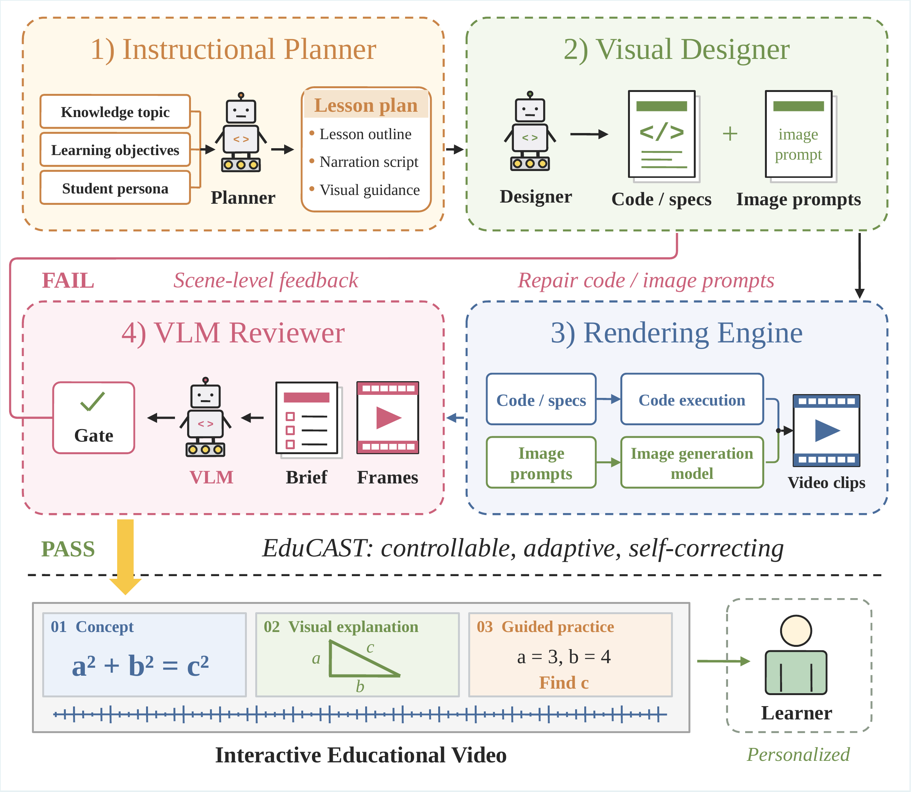

<div align="center">

# EduCAST: A Multi-Agent System for Personalized Educational Video Generation with Closed-Loop Review

**AAAI-27 Demonstration Program**

[**Project page / GUI**](https://darl-genai.github.io/EduCAST/) · [**Video demo**](https://darl-genai.github.io/EduCAST/video/) · [**Source code**](educast/) · [**Instructional Agents**](https://darl-genai.github.io/instructional_agents_homepage/)

</div>

EduCAST turns a topic, a learner profile, and a learning goal into a narrated lesson with
animations, illustrations, and interactive practice. An instructional planner writes a
learner-conditioned lesson plan, a visual designer turns each scene into animation code or an
image prompt, a rendering engine produces narrated media, and a VLM reviewer checks every scene
and repairs only the ones that fail.



## Code layout

```text
requirements/             Python dependencies: base, render, dev, lock
educast/
  assets/                 Fixed fonts, interaction templates, Remotion, GUI artwork
  agents/                 Planner, Manim, Remotion, image, interaction, narration
  reviewloop/             Review, targeted repair, checkpoints and retry loop
  pipeline.py             Connects planning → generation/review → lesson packaging
  bundle/                 Video, captions and interactive player packaging
  studio/                 GUI server and job control
  providers/              API clients and usage accounting
  config.py, schema.py     Configuration and data contracts
examples/                 Teaching requests
tests/                    Regression tests
scripts/                  Static-site build and optional Node compatibility adapter
notebooks/                Colab examples
research/                 Separate comparison and historical evaluation materials
docs/                     Published project page and development documentation
```

## Run locally

From the repository root, with Python 3.10 or later:

```bash
python -m venv .venv
source .venv/bin/activate
python -m pip install -r requirements/base.txt
python -m educast.studio.public --host 127.0.0.1 --port 8091
```

Open <http://127.0.0.1:8091/>. Generating lessons also requires the local rendering
tools and an OpenAI API key; follow [SETUP.md](SETUP.md).

After that setup, the minimal example runs the existing generation and review loop:

```bash
python -m educast --request-json examples/minimal_request.json --run-dir runs/minimal
python -m educast.serve runs/minimal/bundle
```

GitHub Pages serves `docs/`. Rebuild it with `python scripts/build_pages.py`.

## Related projects

- [Instructional Agents](https://github.com/DaRL-GenAI/instructional_agents) (EACL 2026): multi-agent course generation, from learning objectives and syllabus to slides, scripts, and assessments. [Project page](https://darl-genai.github.io/instructional_agents_homepage/)
- [Instructional Agents Studio](https://github.com/DaRL-GenAI/instructional_agents_studio): the course-building app for instructors, `npx instructional-agents`.

## Citation

```bibtex
@inproceedings{chen2027educast,
  title     = {EduCAST: A Multi-Agent System for Personalized Educational Video Generation with Closed-Loop Review},
  author    = {Chen, Qingyue and Nandra, Aarshdeeep Singh and Yao, Huaiyuan and Shourie, Varun and Kazi, Rayan and Wei, Hua},
  booktitle = {Proceedings of the AAAI Conference on Artificial Intelligence (Demonstration Track)},
  year      = {2027}
}
```
