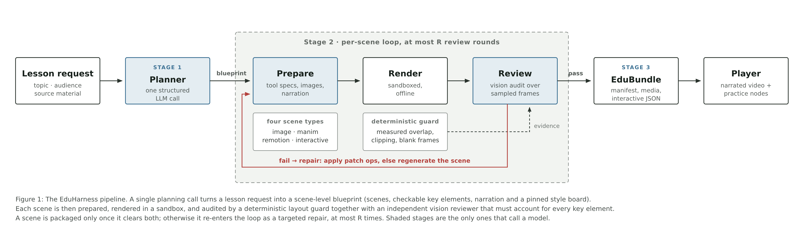

# EduCAST source code

[Project page](https://darl-genai.github.io/EduCAST/) · [Demo](https://darl-genai.github.io/EduCAST/demo/) · [Repository root](../README.md)

Agent pipelines that turn a teaching brief into a **narrated, audited, non-linear lesson** —
planned by an LLM, drawn by sandboxed renderers, and checked scene by scene before anything
is packaged.

The repository holds two generations of the same idea. **`eduharness/` is the current
system**; `legacy/` keeps the pipeline it grew out of, unchanged and still runnable.



---

## Layout

| Path | What it is |
|---|---|
| **`eduharness/`** | **Current system.** Scene-level checkpoints, deterministic layout guards, an independent VLM reviewer, patch-first repair, and an EduBundle player. |
| `legacy/teachgen/` | The predecessor: two-phase plan → render with an MLLM review loop and an evaluator that can drive plan-level and video-level refinement. |
| `legacy/code2video/` | *Not included.* `teachgen` drives [Code2Video](https://github.com/showlab/Code2Video) as its animation renderer; clone it into `legacy/code2video/` to run the legacy pipeline. |
| `legacy/runs/`, `legacy/README.md` | Sample outputs and the original README for that pipeline. |
| `baseline/` | Colab runners that put Code2Video, plain Manim, plain Remotion and TeachingMonster over the same topic set (`topics.xlsx`) for comparison. |
| `notebooks/` | `eval.ipynb` (video evaluation), `run_pipeline.ipynb`, `website_run.ipynb`. |
| `tools/api_usage_tracker.py` | Per-call token / image / TTS ledger with USD pricing, used by the notebook runs. |
| `topics.xlsx`, `data/` | The shared topic set and structured-request summaries. |

Not in this repo: upstream clones (Manim, Remotion, Code2Video, TeachingMonster), generated
media, run directories and virtual environments. See `.gitignore`.

---

## EduHarness — the current system

An LLM plans the lesson, sandboxed tool adapters render each scene, deterministic guards plus
an independent vision reviewer audit every scene, and the result is packaged as a non-linear
**EduBundle** with narration and a hybrid video / interactive player.

```
Stage 1  Main Agent   → LessonBlueprint (scenes + key_elements + narration) + style_config.json
Stage 2  prepare      → API work only: tool specs, diffusion images, TTS narration      (needs key)
         render       → local: Manim (layout-guarded), Remotion beats, image compose,
                        interactive preview; narration muxed into video                 (offline)
         review       → guards (layout / blank frames / DOM overflow) + one structured
                        VLM verdict per scene; failed scenes get targeted repairs        (needs key)
Stage 3  bundle       → EduBundle (manifest.json + media + interactive JSON + player)   (offline)
```

| Scene type | Tool | What the executor emits |
|---|---|---|
| `image` | `gpt-4o` → `gpt-image-2` + Pillow | an expanded English prompt → one complete teaching diagram placed in the board's `main` region |
| `manim` | Manim CE (restricted subprocess) | a `construct()` body only — theme header and layout guard are injected by the host |
| `remotion` | Remotion 4 (pinned template) | one *beat*: `title_card` / `bullets` / `formula` / `compare` / `steps` / `recap` / `stat_row` |
| `interactive` | trusted zero-dependency JS runtime | parameters for `physics_lever`, `multiple_choice`, `drag_sort`, `fill_blank`, `number_line` |

### What makes the loop converge

* **Key elements are a hard constraint.** The planner lists 2–5 checkable things that must be
  visible per scene. The reviewer must classify each as present or missing, and an element it
  fails to classify counts as missing — so "looks fine but shows the wrong thing" cannot pass.
* **Measurement before judgement.** The Manim theme header wraps the scene in `_EduGuardScene`,
  which measures text bounding boxes after every `play()`/`wait()` and samples motion at
  0.25 s intervals. It records text out of frame, text/text collisions, and text intersecting
  sampled Bezier strokes or filled geometry — testing ink, not bounding boxes. It never moves
  a label. Those timestamps become extra review frames, and **guard blockers fail a scene even
  if the VLM is lenient.**
* **A lenient reviewer still cannot pass a broken scene.** A concrete defect parked in a
  non-blocking field is promoted to blocking; rubric echoes are dropped; a scene passes only
  with zero blocking issues and `score >= EDUHARNESS_PASS_SCORE` (default 7).
* **Diff-first repairs, once.** Grounded `ops` are applied locally to the prior artifact — no
  model call, no drift. If a patched scene fails again the defect is structural, so the next
  round regenerates from prior artifact + feedback + guard findings. Pure placement ops are the
  exception and keep their patch route.
* **Failure is explicit.** A reviewer outage is retried and then flagged for a human
  (`debug/<id>_HITL.txt`); it never regenerates the scene and never passes it.
* **Only the broken scenes are redone.** Passed scenes are pinned by prepare/render
  fingerprints — never re-prepared, re-rendered or re-billed.

Evidence strength is deliberately not uniform across renderers: Manim gets the full geometric
guard plus a free regeneration retry, Remotion gets extra first/last frames instead of a runtime
guard, interactive scenes get a DOM-overflow and JS-error audit, and image scenes are the
thinnest — one still, and repairs can only append constraints to the prompt.

### Run it

```bash
cd eduharness
pip install -r requirements-render.txt      # openai, pydantic, manim, playwright, …
python -m playwright install chromium
(cd remotion_template && npm ci)            # pinned Remotion 4.0.200

export OPENAI_API_KEY=sk-...                # or put it in .env (see .env.example)
python -m eduharness --request-json examples/sample_request.json
python -m eduharness.serve runs/<request_id>/bundle    # → http://127.0.0.1:8765/
```

Single stages — `--stage 1 | 2-prepare | 2-render | 2-review | 3`. `2-render` and `3` need no
API key, which is what makes the hybrid Colab/local split work: plan and prepare where the API
is reachable, render locally, sync back, review. Every run writes `usage.json` (tokens, images,
TTS characters, USD).

A local **Render Studio** (`python -m eduharness.studio --runs-dir runs --port 8080`) scans run
checkpoints and starts stages as background jobs, so a notebook or browser disconnect does not
kill a generation. Website and setup: [`eduharness/README.md`](eduharness/README.md); full pipeline documentation: [`eduharness/docs/pipeline.md`](eduharness/docs/pipeline.md).

---

## Legacy pipeline (`legacy/teachgen`)

One OpenAI key plus one structured request produces a narrated teaching video: content is
planned, each segment routed to the best visual renderer, narrated, composited, and passed
through an MLLM review loop. Its evaluator scores a finished video along three dimensions —
content, presentation and pedagogy — through per-chunk extractors, section and lecture
inference, and three rubric graders, and can also be used as an outer video-level refiner
(`--feedback-mode evaluator`) or an inner plan-level refiner
(`--plan-refinement-mode evaluator`). See [`legacy/README.md`](legacy/README.md).

## Evaluation and baselines

`baseline/` drives Code2Video, plain Manim, plain Remotion and TeachingMonster over the topics
in `topics.xlsx` from Colab, so the pipelines are compared on identical inputs.
`notebooks/eval.ipynb` runs the evaluator over finished videos, and
`tools/api_usage_tracker.py` prices every run.
